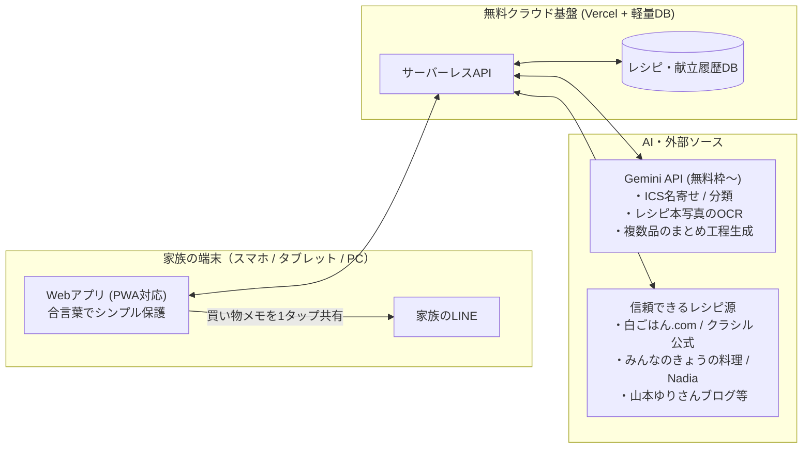

# 家族の料理支援アプリ 設計仕様書

ご家族（お母様・お祖父様・ご自身）が特定のPCに依存せず、スマホやタブレットからいつでも直感的に使える料理支援Webアプリの設計まとめです。

---

## 1. システム構成・利用環境

- **どこからでもアクセス可能**: 無料クラウド（Vercel等＋軽量クラウドDB）に配置し、PCの電源状態に関係なく24時間利用可能。
- **認証は「合言葉」だけ**: 面倒なID/パスワード管理は省き、初回に家族共通の合言葉（パスコード）を入れるだけで端末に記憶。

---

## 2. コア機能とワークフロー

### ① Googleカレンダー過去データの初回インポート（名寄せ＆仕分け）
お母様のGoogleカレンダーから書き出した `.ics` ファイルを読み込ませるだけで、過去の料理履歴を構築します。
- **非料理予定の除外＆分割**: カレンダー内の「美容院」「予定」などをAIが自動除外し、「生姜焼き、味噌汁」のように1つの予定に複数書かれた料理を分割します。
- **表記ゆれの名寄せ**: 「豚の生姜焼き」「しょうが焼き」「ショウガ焼き」などを同一料理として統合し、**「累計で作った回数」**と**「最後に作った日」**を集計します。
- **作成回数に応じたレシピ化**:
  - **高頻度（我が家の定番）**: 「定番（レシピ登録待ち）」として分類。後から山本ゆりさんのレシピ本をスマホで撮影したり、手入力で家庭の味を登録できます（未登録でも仮の材料リストは自動生成）。
  - **低頻度（数回作ったもの）**: Geminiが一般的な材料・手順で仮レシピを自動生成し、画面上でいつでも微調整できます。

### ② 「今の状況」から考える献立作成（主菜・副菜・汁物スロット）
1日分（または数日分）の献立を、以下の優先順位で提案します。
1. **冷蔵庫の余り物・使いたい食材**（「豚バラとキャベツがある」など）
2. **最近作った履歴との被り回避**（直近2週間で作っていない、昨日のメインが肉なら今日は魚など）
3. **食べる人数・メンバーの要望**（「今日は3人分」「ガッツリ系」など）

> [!TIP]
> **家族のリアルな動きに合わせた柔軟な差し替え**
> - **一部固定して残りだけ提案**: 「お祖父ちゃんがメイン（主菜）だけ作ってくれた」「今日は〇〇が食べたいとリクエストがあった」という時は、主菜だけ固定して**それに合う副菜・汁物だけ**をAIに提案させられます。
> - **1品ずつシャッフル**: 提案された候補の中で「これは違うな〜」と思うものだけ、ワンタップで別の候補にランダム変更・手動差し替えができます。

### ③ マンネリを防ぐ「新しいレシピ」の取り込みとストック
クックパッド等の玉石混交サイトは使わず、**白ごはん.com・クラシル公式・みんなのきょうの料理・Nadia・山本ゆりさん（ブログ／レシピ本）**など、信頼できるプロのレシピのみを対象にします。
- **「作ってみたいリスト（ストック置き場）」**: 普段見かけたレシピURLや、レシピ本のスマホ写真をとりあえず放り込んでおける場所。
- **自動＋手動のハイブリッド提案**:
  - 最近過去の定番ばかり続いている時は、自動的に「作ってみたいリスト」や信頼できるサイトから1品混ぜて提案。
  - 気分を変えたい時は**「新メニューに挑戦」ボタン**で新しいレシピから候補を引くことも可能。

### ④ かんたんレシピ追加（3つの入り口）
- **📷 写真から追加（レシピ本OCR）**: 山本ゆりさんのレシピ本や雑誌のページをスマホで撮影するだけで、Geminiが料理名・材料・手順を読み取って自動登録。
- **🔗 URL／信頼サイト検索から追加**: URLを貼るか料理名で検索して自動取り込み。
- **✏️ かんたん手入力**: 料理名とざっくりしたメモだけでも登録可能。

### ⑤ 2段構えの買い物リスト ＆ LINE共有
面倒で挫折しやすい「冷蔵庫の完全な在庫管理」は行わず、買い物前の確認を最小限の手間にします。
- **🛒 メインの買い物リスト（買うもの）**: 献立に必要な肉・魚・メイン野菜・豆腐などを自動合算して表示。
- **🧅 「家にあるかも？確認枠」（常備野菜・基本調味料）**: **玉ねぎ・にんにく・生姜・卵・基本調味料**などはメインリストに混ぜず、すぐ下の別枠にまとめて表示。「あったっけな〜」と見て、切れていたものだけ1タップで上の「買うものリスト」へ追加できます。
- **💬 LINE共有**: 確定した買い物リストを、見やすい箇条書きテキストとして1タップで家族のLINEに送信（そのままアプリ画面をチェックリストとしてスーパーで使うことも可能）。

### ⑥ 複数品を同時並行で作る「まとめ工程ガイド」
キッチンでスマホやタブレットを見ながら調理する際、2つの表示をワンタップで切り替えられます。
- **⏱️ まとめ工程ガイド（並走タイムライン）**:
  - 「① まず主菜・副菜・汁物の野菜をまとめて切る」
  - 「② 汁物を火にかけ、煮える間に副菜を和える」
  - 「③ 最後に主菜を焼いて完成」
  のように、複数品を一番ムダなく同時進行で作る手順にAIが再構成して表示。
- **📖 料理ごとの個別レシピ表示**: 1品ずつの材料・手順を落ち着いて確認したい時用のタブ表示。

### ⑦ カレンダー履歴への自動記録
- 献立を決めたらそのまま「その日のカレンダー履歴」として記録され、今までのGoogleカレンダーと同じ感覚で「いつ何を作ったか」を振り返れます。
- 当日メニューが変わった場合も、後から1タップで実際作った料理に変更・追記できます。
