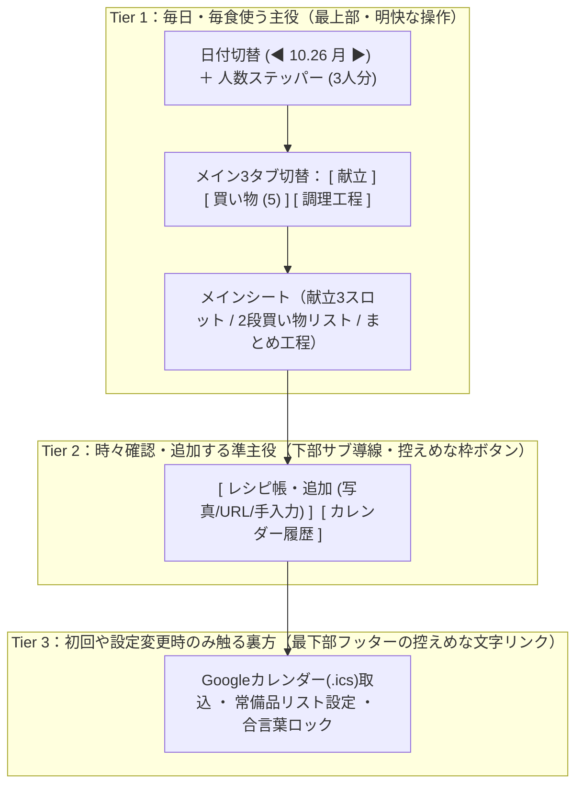

# 家族の料理支援アプリ 要件・詳細設計＆実装計画書

[design_spec.md](file:///C:/Users/HCP4/.gemini/antigravity/brain/db2fa280-5ac6-472b-9577-acd1554f0701/design_spec.md) およびヒアリング結果に基づき、UIデザイン定義・システムアーキテクチャ・データモデル・アルゴリズム・実装タスク分割を定義します。

> [!TIP]
> **インタラクティブUIモックを作成しました**
> 実装前の画面イメージ・操作感（スマホ幅/PC幅プレビュー切替、ライト/ダーク切替、献立の固定・変更、2段構え買い物リスト、まとめ工程切替、裏方のICS取込モーダル）を [ui_mock.html](file:///C:/Users/HCP4/.gemini/antigravity/brain/db2fa280-5ac6-472b-9577-acd1554f0701/ui_mock.html) で実際にクリックして確認いただけます。

---

## 1. Human-Crafted UI デザイン定義書（Phase 2 Specification）

お母様・お祖父様・ご自身の誰もがスマホでもPCでも迷わず使え、「AI生成っぽいテンプレ感（紫グラデ・カード多重入れ子・説明過多・絵文字乱用）」を完全に排除した造形仕様です。

### ① 引き算リスト（削る説明文字・削る箱）
- **UI内の装飾絵文字を全廃**: カレンダーや買い物アイコンに絵文字を使わず、文字のウェイト差と最小限の1.5px線画SVGアイコンのみで整理。
- **日英二重表記・冗長ラベルの廃止**: `MENU // 今日の献立` や `SHOPPING LIST` などの英語併記を禁止し、`献立` `買い物` `調理工程` の短い日本語のみに統一。
- **「箱の中に箱（Nested Cards）」の禁止**: メインシート（1枚）の中にさらに角丸カードを並べず、主菜・副菜・汁物のスロットや買い物項目は **`1px` の水平区切り線（`divide-y`）** だけでフラットに構成。

### ② 空間の空気感とカラートークン（ライト／ダーク切替対応）
レシピ本や「白ごはん.com」のような温かみと文字の読みやすさを両立し、ヘッダーからワンタップでライト・ダークを切り替え可能にします。

| トークン役割 | CSS変数名 | Light Mode (Warm Editorial) | Dark Mode (Atmospheric Dark) | 用途・設計意図 |
| :--- | :--- | :--- | :--- | :--- |
| **全体背景** | `--bg-canvas` | `#FAF9F6` (ウォームオフホワイト) | `#151821` (スモーキーチャコール) | 純白・漆黒を避け、目の疲れを防ぐ温度感のある背景 |
| **メインシート面** | `--bg-surface` | `#FFFFFF` | `#1C202B` | 影ではなく1pxの繊細な境界線で浮き上がらせるシート面 |
| **サブ領域・背景** | `--bg-subtle` | `#F3F2EE` | `#242936` | タブ背景・常備品確認枠のヘッダー等の控えめな面 |
| **基本1px境界線** | `--border-subtle` | `#E6E4DD` | `rgba(255,255,255,0.09)` | リスト区切り線（`divide-y`）・シート外枠 |
| **フォーム・ボタン枠** | `--border-strong` | `#C7C4B8` | `rgba(255,255,255,0.22)` | お母様・お祖父様でも入力欄やボタン位置が即座にわかる高視認枠線 |
| **主テキスト** | `--text-primary` | `#1C1917` (Stone-900) | `#F4F5F7` | 料理名・見出し・主要データ |
| **副テキスト** | `--text-secondary` | `#57534E` (Stone-600) | `#A3ACBF` | 材料リスト・調理手順本文 |
| **補助メタ文字** | `--text-muted` | `#78716C` (Stone-500) | `#6E788C` | 作成回数・前回日付・裏方リンク |
| **唯一の色アクセント** | `--accent-primary` | `#C2410C` (深いテラコッタ) | `#EA580C` (ウォームテラコッタ) | 画面内で最も重要なPrimaryボタン1箇所＆固定バッジのみに使用 |

- **背景の3つのあしらい（Spatial Atmosphere）**:
  1. **大判の透かし日付（Watermark Typography）**: 背後に選択中の日付（`10.26`）を極薄（不透明度 `3.5%`、`tabular-nums`）で配置。
  2. **ほのかな環境光（Soft Ambient Glow）**: 上部にテラコッタ系の極薄環境光（`6%`）をふわっと落とす。
  3. **微細なドット質感（Subtle Dot Matrix）**: 無地の冷たさを消す `20px` 間隔の極薄ドット。

### ③ 「キメる文字 × 読む文字」のタイポグラフィ設計
- **キメる文字（日付 `10.26`・料理名）**: `font-semibold`〜`font-bold`、プロポーショナルメトリクス（`font-feature-settings: "palt" 1`）と等幅数字（`tabular-nums`）を適用。
- **読む文字（調理手順・材料）**: 本文サイズ `14px〜15px`、行間 `leading-relaxed` (`1.75`)、1行最大 `65ch` 以内でキッチンで離れて見ても読みやすい組版。

### ④ スマホ・PC共通シングルコラムと「3段階の情報優先度」
スマホとPCでレイアウト構造を変えず（PCで急に3カラムになって迷うのを防ぐ）、中央寄せのシングルコラム（スマホ時は画面幅、PC/タブレット時は `max-w-xl` / `576px`）に統一します。



---

## 2. システムアーキテクチャ＆技術スタック

新規プロジェクトを `C:\Users\HCP4\.gemini\antigravity\scratch\kazoku-kondate` に作成します。

- **フロントエンド / フレームワーク**: Next.js (App Router, TypeScript) + Tailwind CSS + `shadcn/ui` + `lucide-react`
  - PWAマニフェスト対応（スマホのホーム画面に追加してネイティブアプリのように起動可能）。
- **データベース**: **SQLite / Turso (`@libsql/client` + Drizzle ORM)**
  - ローカル開発や自宅運用ではファイル1つ（`local.db`）でそのまま動き、Vercel等にデプロイする際もTursoの無料枠（クレカ不要・URLとトークンを環境変数に入れるだけ）で家族全員のスマホからリアルタイムに同じデータを読み書きできます。
- **AI・画像認識・検索基盤**: **Google Gemini API (`@google/genai` SDK / `gemini-2.5-flash`)**
  - Structured Outputs（JSON Schema指定）により、表記ゆれ名寄せ・レシピ本OCR・まとめ工程タイムラインを型安全に生成。
- **シンプル合言葉ロック**:
  - Next.js Middlewareで環境変数 `APP_PASSCODE`（例: 家族だけが知る合言葉）をチェックし、一致したら有効期限1年のHttpOnly Cookieを発行。2回目以降は入力不要。

---

## 3. データベース設計（Drizzle Schema）

```typescript
// src/db/schema.ts
import { sqliteTable, text, integer } from 'drizzle-orm/sqlite-core';

// 1. レシピ・料理マスタ（カレンダーから名寄せされた料理＋新規追加レシピ）
export const dishes = sqliteTable('dishes', {
  id: text('id').primaryKey(),
  name: text('name').notNull(),                    // 正規化された料理名（例：「豚の生姜焼き」）
  aliasesJson: text('aliases_json').notNull(),     // カレンダー上の表記ゆれ一覧 JSON (["しょうが焼き", "豚生姜焼き"])
  category: text('category').notNull(),            // 'main' (主菜) | 'side' (副菜) | 'soup' (汁物) | 'other'
  proteinType: text('protein_type'),               // 'pork' | 'chicken' | 'beef' | 'fish' | 'egg_tofu' | 'veggie'
  sourceType: text('source_type').notNull(),       // 'classic_book' (定番・本/手入力) | 'ai_generated' (低頻度AI補完) | 'trusted_web' (信頼サイト) | 'wishlist' (作ってみたい)
  sourceLabel: text('source_label'),               // 例：「山本ゆりさん本 p.42」「白ごはん.com」
  sourceUrl: text('source_url'),                   // 元URL（あれば）
  recipeStatus: text('recipe_status').notNull(),   // 'needs_registration' (定番で写真/手入力待ち) | 'ai_provisional' (AI仮レシピ) | 'confirmed' (登録・確認済)
  baseServings: integer('base_servings').default(3).notNull(),
  ingredientsJson: text('ingredients_json').notNull(), // Array<{ name: string, amount: string, isStaple: boolean }>
  stepsJson: text('steps_json').notNull(),             // Array<string>
  cookCount: integer('cook_count').default(0).notNull(), // カレンダー履歴＋アプリ内での累計作成回数
  lastCookedDate: text('last_cooked_date'),              // YYYY-MM-DD
  createdAt: text('created_at').notNull(),
});

// 2. 日別の献立・作成履歴（カレンダー履歴と直結）
export const dailyMenus = sqliteTable('daily_menus', {
  date: text('date').primaryKey(),                 // YYYY-MM-DD
  servings: integer('servings').default(3).notNull(),
  contextMemo: text('context_memo'),               // 「大根、豚バラ」などの当日メモ
  slotsJson: text('slots_json').notNull(),         // Array<{ role: 'main'|'side'|'soup', dishId: string, dishName: string, locked: boolean, note?: string }>
  parallelStepsJson: text('parallel_steps_json'),  // AIが生成した「まとめ工程ガイド」キャッシュ
  shoppingStateJson: text('shopping_state_json'),  // 買い物リストのチェック状態・常備品から昇格したアイテム
  updatedAt: text('updated_at').notNull(),
});

// 3. 家庭の常備品リスト・アプリ設定
export const appSettings = sqliteTable('app_settings', {
  key: text('key').primaryKey(),                   // 'staple_items' | 'classic_threshold'
  valueJson: text('value_json').notNull(),
});
```

---

## 4. コア機能のアルゴリズム・詳細仕様

### ① Googleカレンダー（`.ics`）インポート＆名寄せパイプライン
1. **クライアント側またはAPIでの `.ics` パース**:
   - `VEVENT` から `DTSTART`（日付）と `SUMMARY`（予定タイトル）を抽出。
2. **Geminiバッチクレンジング＆表記ゆれ名寄せ**:
   - 予定タイトル一覧をGemini (`gemini-2.5-flash`) に渡し、以下のJSONスキーマで構造化：
     - **非料理予定の除外**: 「歯医者」「美容院」「〇〇さんランチ」「ゴミ出し」等を除外。
     - **複合タイトルの分割**: `2026-05-10: "豚の生姜焼き、なめこの味噌汁"` → `["豚の生姜焼き", "なめこの味噌汁"]` に分割し、日付ごとの履歴データ（`dailyMenus`）を生成。
     - **表記ゆれの名寄せ**: `["豚の生姜焼き", "しょうが焼き", "生姜焼き"]` を代表名 `"豚の生姜焼き"` に統合し、累計作成回数（`cookCount`）と最終作成日（`lastCookedDate`）を算出。
3. **作成回数による自動仕分け（しきい値：デフォルト5回）**:
   - **高頻度（5回以上）**: `sourceType = 'classic_book'`, `recipeStatus = 'needs_registration'` として登録（買い物リストが困らないよう仮の主要材料リストは入れつつ、「家庭のレシピ（本の写真・手入力）登録待ち」バッジを付与）。
   - **低頻度（1〜4回）**: `sourceType = 'ai_generated'`, `recipeStatus = 'ai_provisional'` として、Geminiが標準的な材料・作り方を自動補完。

### ② 献立提案エンジン（今の状況＋家族の柔軟な差し替え）
- **入力パラメータ**:
  - `date`（対象日）、`servings`（人数）、`contextMemo`（使いたい食材・要望）、`lockedSlots`（お祖父様が作った主菜やリクエストで固定された枠）、`forceNewChallenge`（新レシピ挑戦フラグ）。
- **選考ロジック**:
  1. **直近履歴の取得**: 過去14日間の `dailyMenus` を取得し、直近で作った料理IDと前日・前々日の `proteinType`（肉・魚など）を特定。
  2. **候補プール抽出**:
     - 使いたい食材（例：「大根、豚バラ」）が指定されていれば、材料または料理名に一致する過去レパートリー＆「作ってみたいリスト」を最優先スコア化。
     - 直近3日間の作成メニューがすべて「過去の定番」だった場合（または「＋新レシピを1品混ぜる」押下時）、自動的に1枠を「作ってみたいリスト」または信頼できるレシピ源から選出。
  3. **1品シャッフル（変更ボタン）**:
     - 各枠（主菜・副菜・汁物）の「変更」ボタンを押すと、固定されていないその枠だけを別候補に即座に切り替え。

### ③ 信頼できるレシピ源からの取得＆写真OCR追加
- **📷 レシピ本・メモの写真OCR（山本ゆりさんの本など）**:
  - スマホカメラまたはアルバムから画像を選択 → `POST /api/recipes/ocr` → Gemini 2.5 Flash Multimodal が料理名・主菜/副菜分類・人数・材料リスト（常備品判定つき）・手順テキストを抽出 → 確認画面で1タップ保存。
- **🔗 信頼できるレシピサイトからのURL・検索取り込み**:
  - 対象ドメインをホワイトリスト管理：
    - 白ごはん.com (`sirogohan.com`)
    - クラシル (`kurashiru.com`)
    - みんなのきょうの料理 (`kyounoryouri.jp`)
    - Nadia (`oceans-nadia.com`)
    - 山本ゆりさん公式ブログ (`ameblo.jp/syunkon`)
    - レタスクラブ (`lettuceclub.net`) / オレンジページ (`orangepage.net`)
  - URL貼り付け時はページのJSON-LD (`schema.org/Recipe`) または本文から材料・手順を抽出し、キーワード検索時はGemini Google Search Groundingで上記ドメインに絞ってレシピ案を取得。

### ④ 2段構えの買い物リスト＆LINE共有フォーマット
- 献立の材料リストを合算する際、`appSettings.staple_items`（デフォルト：`玉ねぎ, にんにく, しょうが, 長ねぎ, 卵, 醤油, みりん, 酒, 砂糖, 味噌, 酢, サラダ油, ごま油, オイスターソース, 片栗粉, だしの素, 鶏ガラスープの素`）に該当するかを判定。
- **上段「買うもの」**: 生鮮肉・魚・メイン野菜・豆腐などを表示。同じ食材（例：主菜の大根 1/2本＋汁物の大根 1/4本）は合算して表示。
- **下段「家にあるかも（常備野菜・調味料の残量確認）」**: 常備品に該当する使用材料をチップ形式で並べ、タップすると即座に上段「買うもの」へ移動。
- **LINE共有**: 未チェックの「買うもの」を `【10/26 買い物メモ】\n・豚バラ薄切り（300g）...` の形式でクリップボードコピー＆スマホ時は `navigator.share` / LINE URLスキーム（`https://line.me/R/share?text=...`）で直接LINEトークへ送信可能。

### ⑤ 複数品の「まとめ工程ガイド」生成
- その日の主菜・副菜・汁物が決まったら、`POST /api/cooking/timeline` で3品の材料・個別手順をGeminiに渡し、以下のルールで並行調理タイムラインを生成（生成結果は `dailyMenus.parallelStepsJson` にキャッシュ）：
  1. **下ごしらえの統合**: まな板を洗う回数を減らすため、野菜→肉/魚の順で全品分のカットと電子レンジ下茹でを最初にまとめる。
  2. **コンロ・火入れの並走**: 煮込み時間や冷まして味を含ませる副菜・汁物を先に火にかけ、最後に主菜を熱々で仕上げる順序に並べる。

---

## 5. Proposed Changes（ファイル構成）

プロジェクトルート: `C:\Users\HCP4\.gemini\antigravity\scratch\kazoku-kondate`

### 基盤・データベース・AIクライアント
#### [NEW] `src/db/schema.ts`
Drizzle ORMによる `dishes`, `dailyMenus`, `appSettings` の3テーブル定義。
#### [NEW] `src/db/index.ts`
`@libsql/client` 接続クライアントと初期シード（常備品リスト初期値・サンプルデータ）の初期化処理。
#### [NEW] `src/lib/gemini.ts`
`@google/genai` (`gemini-2.5-flash`) を使った以下4つの構造化出力関数：
- `normalizeCalendarEvents(events)`: `.ics` 予定リストの名寄せ・非料理除外
- `extractRecipeFromImage(base64Image)`: レシピ本写真のOCR構造化
- `fetchOrGenerateRecipe(queryOrUrl, options)`: 信頼サイト取得・低頻度料理のAI標準レシピ生成
- `generateParallelTimeline(dishes, servings)`: 複数品のまとめ工程生成
#### [NEW] `src/lib/ics-parser.ts`
Googleカレンダーの `.ics` ファイルから日付とタイトルを高速抽出するパーサー。
#### [NEW] `src/lib/shopping-aggregator.ts`
献立の材料リストを人数比でスケーリングし、「買うもの」と「家にあるかも（常備品）」に自動仕分け・合算・LINE共有テキスト化する純粋関数。

---

### API Routes (Next.js App Router)
#### [NEW] `src/app/api/menu/route.ts`
指定日の献立取得・保存・スロット固定/シャッフル・AI献立提案API。
#### [NEW] `src/app/api/cooking/timeline/route.ts`
指定日の複数品から「まとめ工程ガイド」を生成・キャッシュするAPI。
#### [NEW] `src/app/api/recipes/route.ts`
レシピ一覧（定番・作ってみたいリスト・AI仮レシピ）の取得・手入力追加・編集API。
#### [NEW] `src/app/api/recipes/ocr/route.ts`
山本ゆりさんのレシピ本などのスマホ写真からレシピを抽出するAPI。
#### [NEW] `src/app/api/recipes/import-url/route.ts`
白ごはん.com等の信頼できるサイトURLまたはキーワードからレシピを取り込むAPI。
#### [NEW] `src/app/api/ics-import/route.ts`
お母様の `.ics` ファイルをアップロードし、名寄せ・作成回数集計・高頻度/低頻度仕分けを一括実行するAPI。

---

### フロントエンド画面・コンポーネント（Human-Crafted UI準拠）
#### [NEW] `src/app/globals.css`
Warm Editorial (Light) / Atmospheric Dark (Dark) のCSS変数、透かし文字・環境光・ドットマトリクス背景、日本語組版設定。
#### [NEW] `src/app/page.tsx`
シングルコラム・3段階優先度レイアウトのメイン画面（Tier 1: 日付＆人数ヘッダー＋`献立 | 買い物 | 調理工程` タブ、Tier 2: `レシピ帳・追加` / `カレンダー履歴` ドロワー、Tier 3: フッター設定モーダル）。
#### [NEW] `src/components/menu-view.tsx`
使いたい食材・要望入力バー、主菜・副菜・汁物の1px区切りリスト、1品ごとの「固定」「変更（シャッフル）」、新レシピ挑戦ボタン。
#### [NEW] `src/components/shopping-view.tsx`
上段「買うもの」チェックリスト、下段「家にあるかも（常備品）」1タップ昇格チップ、LINE共有コピー＆直接送信ボタン。
#### [NEW] `src/components/cooking-view.tsx`
「まとめ工程（並行タイムライン）」と「料理別（個別レシピ＋写真/編集）」のワンタップ切替ビュー。
#### [NEW] `src/components/recipe-drawer.tsx`
Tier 2「レシピ帳・作ってみたいリスト」と3つの追加方法（本の写真を撮る / 信頼サイトURL・検索 / 手入力メモ）、および「定番レシピの登録待ちリスト」。
#### [NEW] `src/components/history-drawer.tsx`
Tier 2「カレンダー履歴」の振り返り・過去日の献立ワンタップ修正ドロワー。
#### [NEW] `src/components/settings-drawer.tsx`
Tier 3「Googleカレンダー(.ics)取込」「常備品リスト編集」「合言葉ロック」モーダル。

---

## 6. タスク分割（実装ステップ）

承認いただいた後、以下の6ステップで順番に構築・検証します。

| Step | タスク内容 | 主な成果物 |
| :--- | :--- | :--- |
| **Step 1** | **プロジェクト初期化 ＆ デザインシステム構築** | Next.js + Tailwind + `shadcn/ui` 一括導入、`globals.css`（Warm Editorial / Dark テーマ変数・透かし日付背景）の設定 |
| **Step 2** | **DBスキーマ ＆ コアロジック（純粋関数）実装** | Drizzle + LibSQL (`dishes`, `dailyMenus`, `appSettings`)、`.ics` パーサー、2段構え買い物リスト合算・常備品分類ロジック |
| **Step 3** | **Gemini AI 連携サービス ＆ API Routes 実装** | 表記ゆれ名寄せ、献立提案（余り物＋被り回避＋新レシピ混合）、レシピ本写真OCR、信頼サイト取得、まとめ工程タイムラインAPI |
| **Step 4** | **Tier 1 メイン画面（献立・買い物・調理工程）実装** | [ui_mock.html](file:///C:/Users/HCP4/.gemini/antigravity/brain/db2fa280-5ac6-472b-9577-acd1554f0701/ui_mock.html) と同一構造のシングルコラムUI、スロット固定・シャッフル、2段買い物リスト＋LINE共有、まとめ工程切替 |
| **Step 5** | **Tier 2（レシピ帳・履歴）＆ Tier 3（ICS取込・設定）実装** | 写真OCR・URL・手入力レシピ追加ドロワー、カレンダー履歴修正ドロワー、`.ics` インポート＆頻度別仕分け画面、合言葉保護 |
| **Step 6** | **単体テスト・ビルド検証・動作確認** | コアロジックの自動テスト実行、`npm run build` による型・ビルド検証、実画面ウォークスルー作成 |

---

## 7. Verification Plan（検証計画）

### Automated Tests
1. **コアロジック単体テスト (`vitest`)**:
   - `.ics` パーサーが複数予定・終日予定・日本語タイトルを正しく抽出できるか検証。
   - 買い物リスト合算ロジックが「常備品（玉ねぎ・醤油等）」と「買うもの（豚バラ・大根等）」を正しく分離し、1タップ昇格とLINE共有テキスト出力が正しく動作するか検証。
   - 実行コマンド: `npm test`
2. **プロダクションビルド＆型チェック**:
   - 実行コマンド: `npm run build`

### Manual Verification
- 開発サーバーを起動し、以下の一連のフローを検証：
  1. サンプル `.ics` カレンダーデータのインポートと、作成回数に応じた「定番（5回以上）」と「AI仮レシピ（1〜4回）」の自動仕分け。
  2. 主菜を「固定」した状態で「大根、豚バラ」を入力し、副菜・汁物だけが提案・シャッフルされること。
  3. 買い物タブで下段の「家にあるかも（常備品）」をタップして上段「買うもの」へ追加し、「LINE用にコピー」で整形テキストが出力されること。
  4. 調理工程タブで「まとめ工程（3品並行）」と「料理別」が切り替わること。
  5. ライトモード／ダークモード切替と、スマホ幅・PC幅での表示確認。
